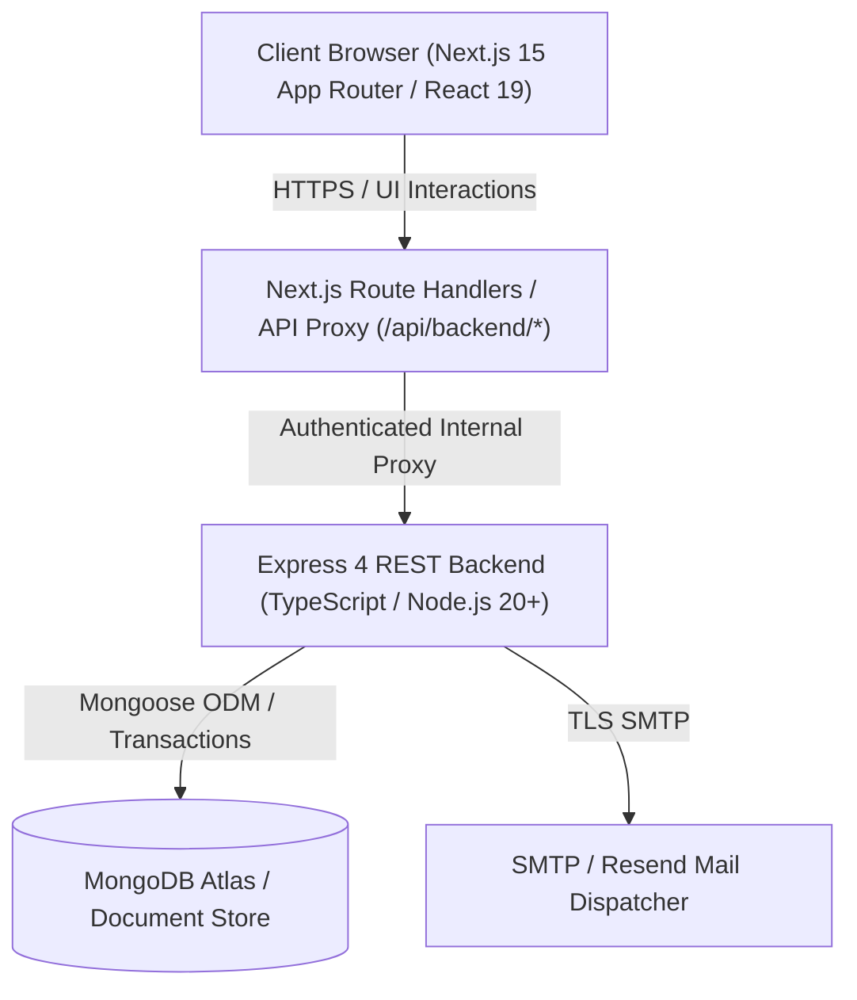

# SOFTWARE REQUIREMENTS SPECIFICATION (SRS)
## Fintarg V2 — Personal Finance & Enterprise Life Management Platform

- **Document ID**: SRS-002
- **Version**: 2.0 (Production Release)
- **Status**: Approved & Baselined
- **Target Platform**: Responsive Web Application (Desktop, Tablet, Mobile)
- **Companion Document**: FRS-002 (Functional Requirements Specification)
- **Classification**: Confidential / Engineering Specification

---

## 1. Introduction

### 1.1 Purpose
This Software Requirements Specification (SRS) establishes the formal architectural, behavioral, performance, and security requirements for **Fintarg V2**. It defines the core design constraints, user classes, data models, external interfaces, and non-functional guarantees governing both the **Basic (Personal/Salaried)** and **Business (Enterprise/Multi-Branch)** editions.

### 1.2 Scope
Fintarg V2 is an integrated personal finance, double-entry cash flow ledger, and small-to-medium enterprise management platform designed specifically for the Sri Lankan economic context. The system provides:
1. **Double-Entry Financial Ledger**: Multi-account bank management, built-in non-deletable cash wallet, credit/debit card tracking, and two-legged fund transfers with real-time running balance calculation and strict zero-drift invariants.
2. **Commitment & Debt Management**: Reducing-balance and flat-interest loan calculation, month-by-month amortization, early payoff computation, pawned jewellery tracking with part-principal redemption, and recurring lease/cheque tracking with auto-advancing due dates.
3. **Budgeting & Goal Capitalization**: Dynamic days-in-month budget allowances, month-specific spending targets, and savings goals linked directly to ledger accounts.
4. **Analytics & Financial Health Scoring**: Multi-metric financial health ring (0–100), liquidity runway calculation, cash-flow waterfall diagrams, weekday spending heatmaps, and month-over-month variance analysis.
5. **Document Vault & Formal Correspondence**: Encrypted storage for KYC documents and formal business letter generation with auto-populated bank details and pristine A4 print styling.
6. **Enterprise & Multi-Branch Workspaces (Business Plan)**: Multi-company management, operating branch registration, daily sales registers, operational cost tracking, director draws, and commercial legal agreements.

### 1.3 Definitions and Acronyms
- **EMI**: Equated Monthly Installment.
- **EPF / ETF**: Employees' Provident Fund / Employees' Trust Fund (Sri Lanka statutory employment deductions).
- **APIT**: Advance Personal Income Tax.
- **Drift**: Discrepancy between cached account balance (`balanceCents`) and the computed ledger sum (`openingBalanceCents + sum(signed transactions)`).
- **Two-Legged Transfer**: A linked financial movement generating two paired transactions sharing a `transferGroupId` (`outgoing` from source, `incoming` to destination).
- **Cents**: Monetary integer storage representing 1/100th of a currency unit (LKR cents) to eliminate floating-point arithmetic errors.

---

## 2. Overall Description

### 2.1 Product Perspective
Fintarg V2 operates as a modern decoupled full-stack web application:

### 2.2 User Classes and Characteristics
1. **Basic Edition User (Personal / Salary)**:
   - Salaried individuals, government workers, freelancers.
   - Primary focus: Monthly take-home salary, household living expenses, personal debt commitments, savings goals, and daily personal spending allowances.
2. **Business Edition User (Enterprise / Company)**:
   - Sole proprietors, directors, SME owners.
   - Primary focus: Company registrations, branch operations, daily revenue logs, utility overheads, owner draws, commercial agreements, and corporate letters.
3. **Dual-Earner (`both` work mode)**:
   - Users with both salaried employment and operating business ventures.
   - Seamlessly toggles between personal household ledgers and commercial enterprise workspaces.
4. **System Administrator / Automated Cron**:
   - Headless background service executing routine maintenance, expired session cleanup, and scheduled reminder emails authenticated via constant-time secrets.

### 2.3 Operating Environment
- **Server Runtime**: Node.js >= 20 LTS on Linux / Containerized environments (Docker / Vercel).
- **Client Browsers**: Modern evergreen browsers (Chrome 110+, Safari 16+, Firefox 110+, Edge 110+, Mobile Safari, Chrome Android).
- **Database**: MongoDB 7.0+ or MongoDB Atlas Replica Set (supporting multi-document ACID transactions).

### 2.4 Design and Implementation Constraints
- **Zero Floating-Point Drift in Currency**: All financial amounts in the database must be stored as signed 64-bit integers in cents (`amountCents`, `balanceCents`, `openingBalanceCents`). Conversion to major units occurs strictly at the presentation layer.
- **Strict Date Validation**: Calendar dates must adhere strictly to `YYYY-MM-DD` ISO format validated for true calendar existence (e.g. rejecting `2026-02-31`).
- **Stateless Authentication**: JWT bearer tokens stored in secure `HttpOnly`, `SameSite=Strict` cookies with instant revocation capability via atomic `tokenVersion` increments.

---

## 3. External Interface Requirements

### 3.1 User Interfaces
- **Responsive Layout**: Fluid breakpoints supporting Mobile (<640px), Tablet (640px–1024px), Desktop (1024px–1440px), and Ultra-wide (>1440px).
- **Design System Tokens**: Fully variable-driven CSS engine (`globals.css`) supporting Dark Mode and custom 6-digit hex brand accents (`deriveBrand`, `deriveSidebarStyles`).
- **Accessibility & Contrast**: Conformance with WCAG 2.1 AA standards for text contrast across light and dark themes.
- **Print Optimization**: Dedicated `@media print` stylesheets that strip interactive navigation, modals, and shadows, formatting reports and formal letters to exact A4 standard dimensions.

### 3.2 Hardware Interfaces
- No dedicated hardware interfaces. Operates standard client device displays and camera/file picker inputs for document attachments.

### 3.3 Software Interfaces
- **Database Engine**: Mongoose ODM over MongoDB connection pools.
- **Authentication Proxy**: Next.js route handlers proxying authenticated client requests to the Express backend with header propagation (`x-forwarded-for`, `cookie`, `x-real-ip`).
- **Email Service**: External transactional email provider (Resend API or SMTP) configured via environment variables.

### 3.4 Communications Interfaces
- **Protocols**: HTTPS over TLS 1.3 mandatory in production.
- **Content Types**: `application/json` for API requests; `multipart/form-data` with magic-byte content inspection for secure file uploads.

---

## 4. Non-Functional Requirements (NFRs)

### 4.1 Performance Requirements
1. **API Latency**: 95% of standard CRUD requests must resolve within <= 120ms under normal load.
2. **Transaction History Aggregation**: Aggregated running balances with `$setWindowFields` across 10,000+ transaction records must execute within <= 250ms using compound indexes `{ userId: 1, bankAccountId: 1, date: -1 }`.
3. **Client-Side Responsiveness**: First Contentful Paint (FCP) <= 1.2s; Time to Interactive (TTI) <= 2.0s on standard 4G connections.

### 4.2 Security Requirements
1. **Credential Protection**: Passwords hashed using `scrypt` with a cryptographically secure 16-byte random salt. Non-existent user logins execute dummy hash operations in constant time to prevent timing enumeration.
2. **Session Revocation**: Every authenticated request evaluates `user.tokenVersion === payload.tokenVersion`. Changing passwords or calling `/api/auth/logout-all` immediately revokes active sessions across all devices.
3. **Account Lockout**: 5 consecutive failed login attempts lock the account for 15 minutes. Lockout state auto-resets upon duration expiry.
4. **File Upload Security**: Verification of actual file magic bytes (signatures) for PDF, PNG, JPEG, WEBP, and DOCX. Executable or spoofed MIME types are rejected with HTTP 415. Strict size limits: 2MB for avatars, 4MB for documents.
5. **Data Purge & Cascade**: Account deletion (`DELETE /api/auth/account`) requires password re-authentication and exact confirmation string `"DELETE MY ACCOUNT"`, executing atomic cascade deletions across all 25+ MongoDB collections.

### 4.3 Reliability and Ledger Consistency
1. **Zero Balance Drift**: The ledger service enforces double-entry balance integrity:
   $$\text{Current Balance} = \text{Opening Balance} + \sum(\text{Incoming}) - \sum(\text{Outgoing})$$
   Any operation causing a non-zero drift triggers automated sync and warning logs.
2. **System Row Immutability**: Transactions created automatically by source documents (expenses, incomes, transfers, repayments, pawn payments) cannot be modified or deleted directly through generic transaction endpoints (`403 Forbidden`). Mutations must occur through the parent business entity.
3. **Account Deletion Safeguard**: A bank account cannot be deleted if its balance is non-zero or if active un-reversed transactions exist.

### 4.4 Data Portability
- Users can download their complete financial, profile, and enterprise history at any time via `GET /api/profile/export`, yielding an indented JSON archive omitting sensitive credential hashes.

---

## 5. Architectural Verification & Acceptance Criteria
- **Property-Based Verification**: The system must pass automated randomized property tests (`verifyLedger.ts`) executing 50+ interleaved financial actions (transfers, repayments, redemptions, undos) with `driftCents === 0` asserted after every single operation.
- **CI / CD Pipeline**: Continuous integration runs full backend TypeScript typechecks, unit/integration test suites (150+ tests), and frontend Next.js production builds before any branch merge.
